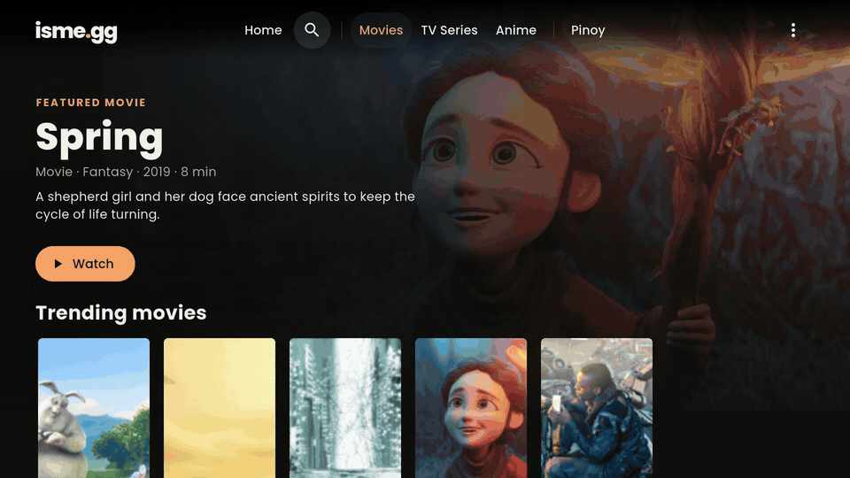
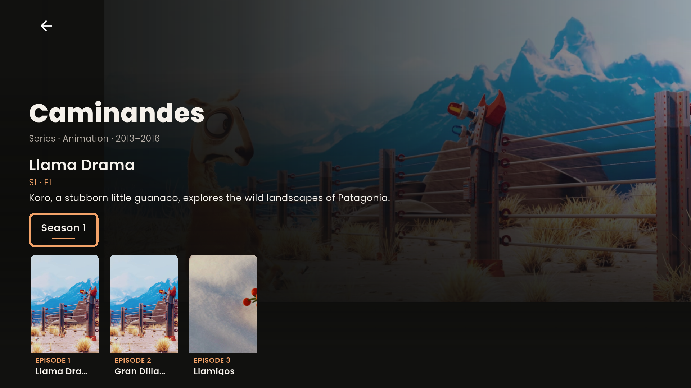
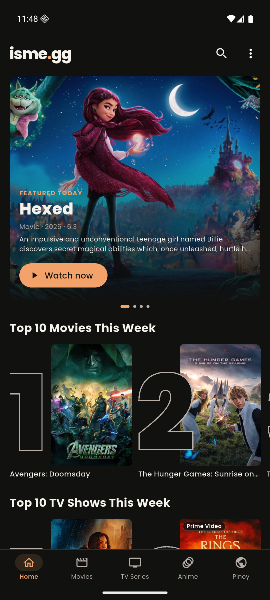
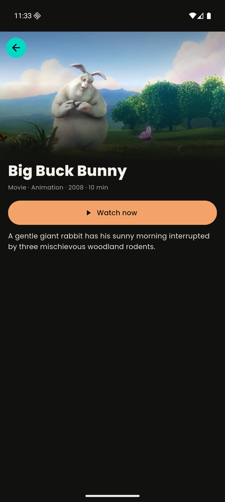

# isme.gg

isme.gg is a native media app for Android phones and Android TV. Browse movies, TV series, anime and Filipino cinema, then play media you have permission to access.

[Download APK](https://github.com/bastilavarias/isme.gg/releases/latest/download/isme.apk) · [Official website](https://bastilavarias.github.io/isme.gg/) · [Latest release and changelog](https://github.com/bastilavarias/isme.gg/releases/latest) · [Report a problem](https://github.com/bastilavarias/isme.gg/issues/new)

## Android TV

Use the D-pad to browse posters, switch catalogs and move between seasons. The layout keeps artwork and navigation readable from across the room.

## Android phones and tablets

  
  

Browse in portrait or landscape. Search across categories and resume supported titles from Continue watching. The fullscreen player offers seeking, subtitle options and audio track selection when available.

## Install and update

1. Get the current signed APK from the [official download page](https://bastilavarias.github.io/isme.gg/#download). The page shows its version, publication date, file size and changelog.
2. On your phone or TV, open the downloaded APK. On Android TV, transfer it from another device if needed.
3. Follow Android's installation prompts. If Android asks for permission, allow installation for the app opening the APK. You can revoke that permission afterward.
4. Open isme.gg from the Android or Android TV launcher. To check for a newer stable build, open the app menu and choose **Check updates**.

The same APK supports phones, tablets and Android TV running **Android 9 or later** on **ARM64** or **ARMv7**. Published releases include a SHA-256 checksum and an update manifest.

## Architecture and privacy

Flutter renders the phone and TV interfaces. A Java Android bridge runs libtorrent4j on the device and serves app-private playback over an authenticated loopback connection. The native player uses Android Media3. GitHub Pages serves the website, and GitHub Releases provides the signed APK and update metadata.

Browsing requires external metadata services. Watch history, playback settings and the catalog cache are stored on the device. Playback can connect to peers that can see your network address. Use only media you have permission to access. Streaming platform names indicate discovery filters and availability information. isme.gg is independent of those services.

## Development and support

Start with [DEVELOPMENT.md](DEVELOPMENT.md) for the pinned Android and Flutter toolchain and emulator instructions. [RELEASE_UPDATES.md](RELEASE_UPDATES.md) explains release signing and updater verification. Include your app version, Android version, device model and reproduction steps in a [bug report](https://github.com/bastilavarias/isme.gg/issues/new).

## Preview credits

The screenshots and demo show the running app with a curated Blender open-movie catalog.

- **Big Buck Bunny** © 2008 Blender Foundation / www.bigbuckbunny.org. [CC BY 3.0](https://peach.blender.org/about/).
- **Sintel** © Blender Foundation / www.sintel.org. [CC BY 3.0](https://durian.blender.org/sharing/).
- **Elephants Dream** © 2006 Blender Foundation / Netherlands Media Art Institute / www.elephantsdream.org. [CC BY 2.5](https://orange.blender.org/blog/creative-commons-license-2/).
- **Caminandes** © Blender Foundation. [Creative Commons Attribution](https://studio.blender.org/remixing/).
- **Spring** and **Tears of Steel** © Blender Foundation. [Creative Commons Attribution](https://studio.blender.org/remixing/).
